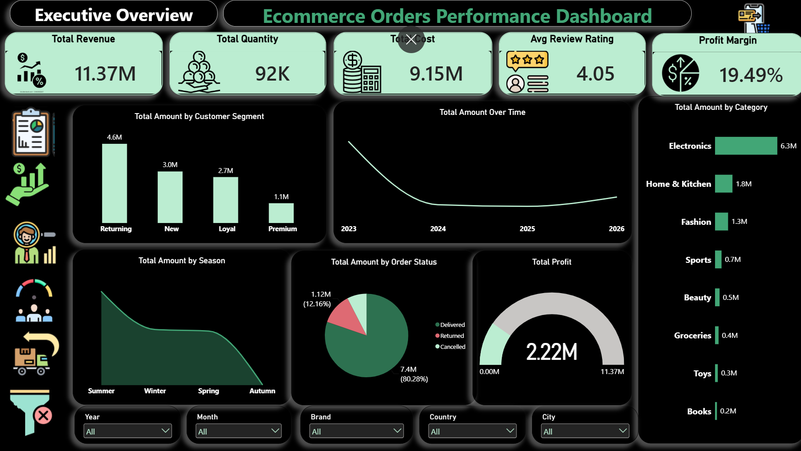
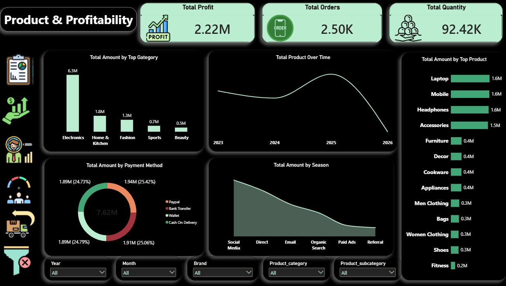
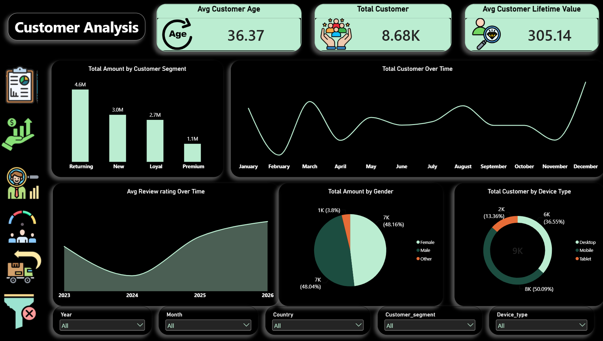
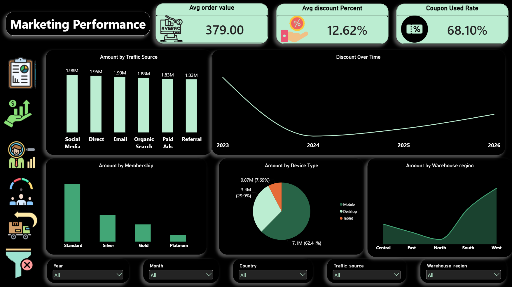
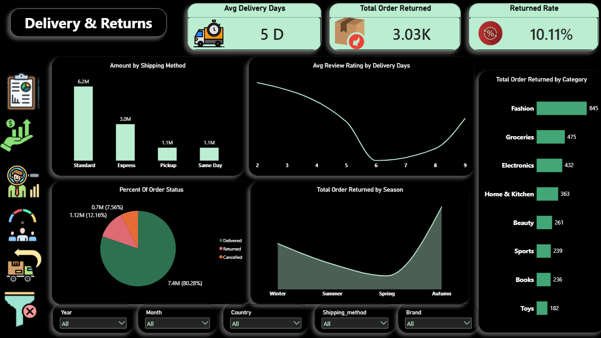

# E-Commerce Orders Performance & Customer Analytics

## Project Overview

An end-to-end e-commerce data analysis project focused on evaluating business performance, customer behavior, marketing effectiveness, and operational efficiency using Excel, Python, and Power BI.

The project transforms raw e-commerce data into actionable business insights through data cleaning, exploratory analysis, and interactive dashboards.

## Tools & Technologies

- Microsoft Excel
- Python (Pandas, NumPy, Matplotlib)
- Power BI
- Data Cleaning & Exploratory Data Analysis (EDA)
- Data Visualization & Business Intelligence

## Dashboard Preview

[View Interactive Power BI Dashboard](https://app.powerbi.com/groups/me/reports/1630c3b9-0f68-4556-b91a-8e35666cbc69/af0c4e8c19b118c1ea81?experience=power-bi)

### 1. Executive Overview


### 2. Product Performance


### 3. Customer Insights


### 4. Marketing Performance


### 5. Delivery & Returns



## Key Business Insights

- Total Revenue: **$11.37M**
- Total Cost: **$9.15M**
- Total Profit: **$2.22M**
- Profit Margin: **19.49%**
- Total Quantity Sold: **92K**
- Average Review Rating: **4.05/5**
- Electronics generated the highest category revenue at **$6.3M**.
- Returning customers contributed **$4.6M** in revenue.
- Social Media was the leading marketing channel, generating **$1.98M**.
- Fashion recorded the highest number of returned orders (**845**).

## Data Source

- Dataset: E-Commerce Orders Dataset.
- Format: CSV.
- Data preparation and cleaning using Excel and Python.
- Exploratory Data Analysis (EDA) using Python.
- Interactive visualization and reporting using Power BI.

## Project Objectives

- Analyze overall e-commerce business performance.
- Identify key revenue-generating product categories.
- Understand customer purchasing behavior.
- Evaluate marketing channel performance.
- Investigate product returns and fulfillment efficiency.
- Support data-driven business decisions.

## Repository Structure

```text
E-Commerce-Analysis/
│
├── Dataset/
│   └── Raw_Data.csv
│
├── Python/
│   └── Data_Analysis.ipynb
│
├── Screenshots/
│   ├── Overview.png
│   ├── Products.png
│   ├── Customers Analysis.png
│   └── Marketing Performance.png
│   └── Delivery & Returns.png
├── Business_Insights/
│   └── E-Commerce_Business_Insights.pdf
│
└── README.md
```

## Project Outcome

Developed a four-page interactive Power BI dashboard supported by Excel and Python analysis, providing insights into financial performance, customer behavior, marketing effectiveness, and logistics operations.
